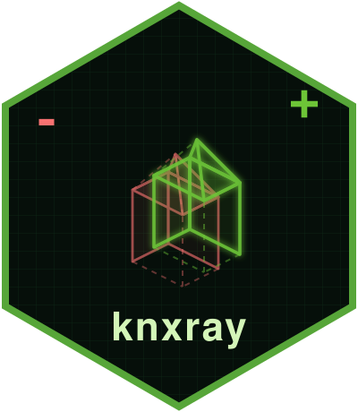

# knxray 

[KNX](https://www.knx.org) is a building-automation standard for lighting,
heating, blinds, and similar systems.
Installations are configured in
[ETS](https://www.knx.org/knx-en/for-professionals/software/ets-6/),
a proprietary Windows application that stores its project state
in `*.knxproj` files: zipped XML archives.

knxray converts the parts of these files that
[xknxproject](https://github.com/XKNX/xknxproject) can parse into stable JSON.
It supports local inspection and git textconv, not editing projects
or displaying every ETS change.

## Quick start

Inspect a file without installing knxray:

```sh
nix run github:dataheld/knxray -- show my-installation.knxproj
```

Install it and configure git in a repository containing `.knxproj` files:

```sh
nix profile install github:dataheld/knxray
knxray setup
```

Git must be on your `PATH`.
See the [usage guide](https://knxray.maxheld.de/usage/) for source installation,
command behavior, and global git configuration.

## Example

Without knxray, committing a `*.knxproj` to git means `git diff` tells you nothing:

```console
$ git diff HEAD -- my-installation.knxproj
diff --git a/my-installation.knxproj b/my-installation.knxproj
Binary files a/my-installation.knxproj and b/my-installation.knxproj differ
```

With knxray installed and configured, the same command shows:

<!-- BEGIN git-diff-example -->

```diff
diff --git a/my-installation.knxproj b/my-installation.knxproj
index 255ab14..c04674e 100644
--- a/my-installation.knxproj
+++ b/my-installation.knxproj
@@ -153,36 +153,6 @@
       "number": 1,
       "object_size": "1 Bit",
       "text": "S1.1: Schalten (steigende Flanke)"
-    },
-    "1.1.3/O-3_R-36": {
-      "channel": "CH-2",
-      "description": "",
-      "device_address": "1.1.3",
-      "device_application": "M-0007_A-6125-96-F910",
-      "dpas": null,
-      "dpts": [
-        {
-          "main": 1,
-          "sub": 1
-        }
-      ],
-      "flags": {
-        "communication": true,
-        "read": false,
-        "read_on_init": false,
-        "transmit": true,
-        "update": true,
-        "write": true
-      },
-      "function_text": "Input/Output",
-      "group_address_links": [
-        "0/0/2"
-      ],
-      "module_def": null,
-      "name": "Obj_Wert_steigendeFlanke",
-      "number": 3,
-      "object_size": "1 Bit",
-      "text": "S1.2: Schalten (steigende Flanke)"
     }
   },
   "devices": {
@@ -311,8 +281,7 @@
         }
       },
       "communication_object_ids": [
-        "1.1.3/O-1_R-17",
-        "1.1.3/O-3_R-36"
+        "1.1.3/O-1_R-17"
       ],
       "description": "Countertop",
       "hardware_name": "6125/01 ctrl. el., solo\u00ae stand., 1gang, fl. mtd.",
@@ -349,8 +318,7 @@
       "comment": "",
       "communication_object_ids": [
         "1.1.1/O-0_R-16",
-        "1.1.2/O-3_R-36",
-        "1.1.3/O-3_R-36"
+        "1.1.2/O-3_R-36"
       ],
       "data_secure": false,
       "description": "",
```

<!-- END git-diff-example -->

> **Partial view:**
> `xknxproject` only parses a *subset* of your `*.knxproj`,
> including group addresses, devices, and communication objects.
> Device parameters (for example, a dim curve) live in opaque per-device XML
> and are **not** shown.
> A clean diff here does **not** mean the `.knxproj` files are identical.
> `knxray diff` emits a warning when the normalized project XML differs
> but the parsed JSON does not.

Git integration invokes `knxray show`, not the comparison cascade.
It cannot warn about changes invisible to the JSON parser.
GitHub and GitLab web interfaces do not run textconv.
See [limitations](https://knxray.maxheld.de/limitations/) and
[related tools](https://knxray.maxheld.de/related/).
